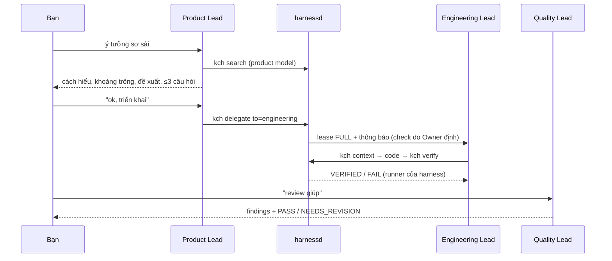

# 07 — Cách người dùng làm việc với đội V5

Đội V5 gồm bốn agent OpenBot thật, cấu hình qua Agent Settings: **Product Lead**, **Design Lead**,
**Engineering Lead** và **Quality Lead**. Role ở `prompts/roles/` (SHARED + một file mỗi role), nạp vào
mỗi agent qua `AGENTS.md` của workspace (cơ chế Instructions của OpenBot). Harness (`harnessd`) thực thi
quyền, ngân sách, phạm vi ghi và verify khi chạy; role chỉ mô tả cách làm việc.

## 1. Một channel mỗi project

| Thành phần | Ở đâu |
|---|---|
| Channel `<project> · V5` | OpenBot, `isolated: true` (memory của channel ở lại channel), lead = Product Lead |
| Project, repo, product model, ngân sách | harness: `kch owner POST /v1/projects …` (Owner, một lần) |
| Thành viên + vai trò | harness: Product Lead = `lead`; Design / Engineering / Quality = `worker` có `specialty` |
| Check bắt buộc cho việc do agent giao | harness: `PUT /v1/projects/{p}/delegate-policy` (Owner) |

## 2. Ai trả lời

| Bạn nói | Người trả lời | Có sửa code không |
|---|---|---|
| Ý tưởng, nghiệp vụ, "nên làm gì" (DISCUSS / RESEARCH) | Product Lead | Không |
| "Thiết kế màn…", "làm prototype" (DESIGN) | Design Lead | Chỉ file prototype `.html` |
| "Triển khai…", "sửa lỗi…" (IMPLEMENT / FIX) | Engineering Lead, khi đã có task | Có, trong phạm vi task |
| "Review", "kiểm tra giúp" (VERIFY) | Quality Lead | Không |
| Feedback giữa chừng (FEEDBACK) | Agent đang giữ task đó | Chỉ phần bị ảnh hưởng |

Gọi đích danh một agent trong channel thì agent đó trả lời. Không gọi tên thì Product Lead (channel lead)
nhận và chuyển. Không có workflow bắt buộc kiểu CEO → Product → Design → Engineering → QA: việc nhỏ
(một màn, một hàm, một quy tắc) đi thẳng tới một agent.

## 3. Từ ý tưởng tới code



- Engineering Lead không tự mở task cho mình. Lead giao, harness cấp lease (PM-S2-20; spec
  `docs/specs/harness-s2-team-spec.md`).
- Tham vấn giữa agent: `kch consult <chuyên môn> '<câu hỏi>' --refs <keys>`: một câu hỏi cụ thể kèm
  nguồn, không chuyển cả hội thoại, có hạn mức.
- Mỗi repo một lease ACTIVE: trong một repo đội làm tuần tự; song song giữa các project.

## 4. Memory và context

| Lớp | Nội dung | Ai ghi |
|---|---|---|
| PROJECT (harness, PostgreSQL) | Product model: quy tắc, quyết định, giả định, có trust Authoritative / Observed / Candidate / Historical | Owner duyệt; agent đề xuất (`kch propose`, `kch note`) |
| AGENT (harness) | Ghi nhớ riêng của agent trong project | agent (`kch remember`) |
| GLOBAL (harness) | Bài học đã xác thực dùng chung | Owner |
| Channel memory (OpenBot) | Tóm tắt hội thoại của channel, `isolated` | OpenBot |

Mỗi lượt, hook `UserPromptSubmit` nạp context packet đúng project của lease, đúng revision. Project lấy
từ lease, không bao giờ từ lời agent.

## 5. Bắt đầu một project mới (Owner, một lần)

```bash
kch owner POST /v1/projects '{"slug":"my-app","name":"My App"}'
kch owner POST /v1/projects/<P>/repos '{"path":"/var/tmp/kc-pilot/repos/my-app"}'
kch owner PUT  /v1/projects/<P>/limits '{"default_task_max_cost_microusd":400000}'
kch owner PUT  /v1/projects/<P>/delegate-policy '{"required_checks":[{"id":"unit","command":"go test ./..."}]}'
# thêm 4 principal vào project (lead / worker + specialty), rồi kch enroll cho từng workspace
```

Sau đó mở channel `my-app · V5` trong OpenBot với bốn agent và nói ý tưởng.

## 6. Vòng đời agent

- Bốn Lead là đội cố định, tạo một lần bằng `openbot.create_agent`, nằm trong mục sidebar **V5 Team**. Project mới dùng lại đúng bốn agent này qua `deploy/team/add_project.py` (idempotent theo slug, không tạo agent). Instructions áp lại bằng `evals/team/setup_team.py --roles` (chỉ ghi khi nội dung đổi).
- Worker tạm: subagent của Claude Code chỉ sống trong một lượt. Agent đã ghi danh không gọi được `openbot.create_agent` (mọi `mcp__*` bị chặn), nên không tự sinh agent thường trực.
- Hai agent pilot chỉ dùng cho benchmark: đã tắt Local scripts, thông báo và Computer Use, chuyển vào mục **V5 Pilot (archived)**; kết quả lưu ở `.work/abc`. OpenBot không có lệnh archive hay xóa agent, và lịch sử không bị xóa.
- Cùng một Lead làm nhiều project: harness tách memory theo project (RLS; pilot đo được 0/76 packet lọt project); mỗi channel có session riêng; memory tự động của OpenBot gắn theo agent nhưng ở mức `searchable`, không tự nạp vào prompt. Thư mục tạm của agent dùng chung cho mọi project.

## 7. Giới hạn hiện tại

- Hook harness chỉ có cho Claude Code. Backup model nên giữ trong provider Claude; chuyển sang
  Codex/Cursor sẽ bỏ qua cơ chế thực thi của harness.
- `access: workspace` của OpenBot (Claude) không nạp `.claude/settings.json` của workspace, nên agent
  có harness phải để `full`; giới hạn quyền do sandbox của harness đảm nhận.
- L1′: mọi tiến trình không sandbox cùng uid là Owner (`docs/specs/harness-s2-spec.md` §A.3).
