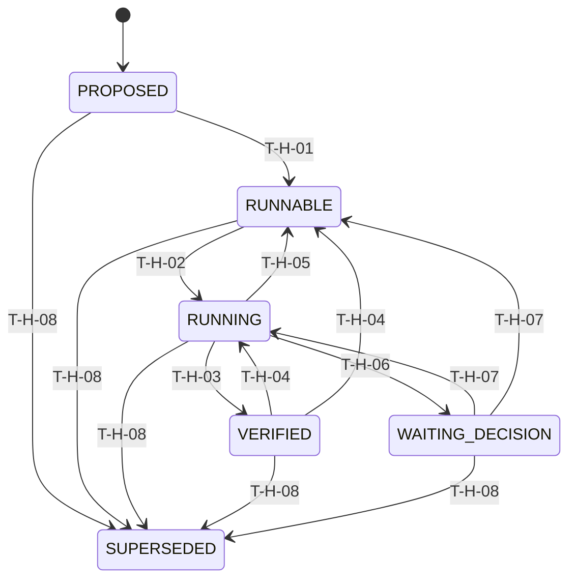
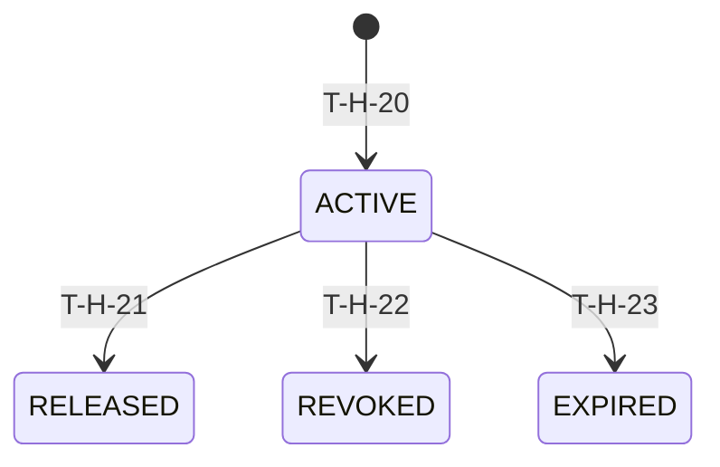

# Harness S1 — lát cắt dọc đầu tiên

Nguồn: Master Prompt V5.0 §3, §5–§8, §12–§14, §16, §19; V4.1 docs/03, 04, 09, 12. Context: `_context.md`.
Phạm vi S1: một agent Claude thật của kongCowork nhận task → được nạp context đúng phiên bản mỗi lượt → bị chặn ghi ngoài phạm vi → token/chi phí cộng dồn vào ngân sách task → kết quả chỉ VERIFIED khi runner chạy thật trên đúng candidate → feedback giữa chừng thu hồi lease và điều hướng tại điểm an toàn.

Định hướng V5 Lightweight (cập nhật 2026-11-17): bốn nhóm trách nhiệm trong một tiến trình, không phải bốn dịch vụ.

| Nhóm | Có trong S1 | Để sau khi S1 chứng minh giá trị |
|---|---|---|
| Memory & Context | Live Product Model (hiện trạng AS_IS vs mong muốn TO_BE), trust Authoritative/Observed/Candidate/Historical, bộ nhớ theo agent + kiến thức chung, tìm exact + FTS + trigram, context packet | Embedding pgvector, đồ thị phụ thuộc từ code (Tree-sitter/LSP) |
| Adaptive Runtime | Một agent chịu trách nhiệm chính mỗi task (lease), hook Claude nạp context / chặn ghi / chặn khi hết ngân sách, tailer usage, feedback chỉ ảnh hưởng task liên quan | Hook chặn cho Codex/Cursor/ACP (cần seam lõi), hủy lượt đang chạy |
| Engineering & Verification | Runner chạy check thật trên đúng candidate, check `scope`, evidence không tự khai | Merge queue/INTEGRATED, sandbox Docker cho runner, kiểm chứng UI bằng Playwright |
| Intelligence & Collaboration | Blackboard dạng delta có tham chiếu, mục "chưa chắc chắn" đưa vào context kèm chỉ dẫn tự nghiên cứu trước khi hỏi, gợi ý mức DIRECT/ASSISTED/DEEP (chỉ là gợi ý) | Router tự kích hoạt đa agent, giới hạn độ sâu tham vấn do runtime cưỡng chế, incident budget |

Phân biệt bắt buộc (V5L §9): **quan sát** (tailer SQLite, mọi provider) khác **can thiệp** (hook Claude: chèn context, từ chối tool, chặn dừng). Chưa có đường **hủy lượt** không qua Team API. Không coi tailer hay MCP là đã tích hợp đầy đủ.

Ngoài S1 (ghi rõ, không làm ngầm): UI web, checkpoint, state FAILED, thu hồi token, đổi vai trò/gỡ thành viên, task cha–con, MCP server, theo dõi tiến độ suy luận (chống lặp), tự phát hiện mâu thuẫn giữa các mục kiến thức, tự cập nhật requirement từ feedback (S1 chỉ lưu nguyên văn và nạp cho agent). Giá trị của S1 được đo bằng so sánh A/B/C với agent thật (`evals/README.md`), không bằng số test PASS của chính harness.

## 0. Đa Project và cách ly (bắt buộc từ đầu)

Một `harnessd`, một database, nhiều Project chạy đồng thời. Cách ly ở ba tầng, tầng dưới không tin tầng trên:

1. **Danh tính Project lấy từ runtime, không từ model.** Token → principal → membership; hook → lease ACTIVE → task → project. `project_id` trong body bị bỏ qua. Khi principal đang giữ lease ACTIVE, mọi request có project trong đường dẫn phải trùng project của lease, nếu không trả 409 (agent không tự chuyển project giữa chừng). CLI `kch` của agent không nhận tham số project: lấy từ lease, hoặc từ membership duy nhất; không xác định được thì từ chối.
2. **Backend scoping.** Mọi truy vấn chạy trong `store.InScope` với (role, principal, danh sách project của principal).
3. **PostgreSQL Row-Level Security, mặc định từ chối.** Mọi kết nối của pool chạy dưới vai trò `harness_app` (không sở hữu bảng); thiếu scope thì không thấy hàng nào. Policy lọc theo `project_id` kể cả khi câu SQL quên điều kiện. Hook đọc context và tìm kiếm **dưới scope của agent**; scope runtime chỉ dùng cho: tra token, ghi ledger / evidence / agent turn / con trỏ / hash hook, cập nhật số đã dùng của ngân sách, và chuyển state do Runtime kích hoạt. Agent không ghi được mục AUTHORITATIVE, evidence, ledger; Worker không sửa được task hay lease của người khác; không có quyền DELETE ở bảng nào. Khóa ngoại kép `(task_id, project_id)` chặn hàng trỏ sang task của project khác.
4. **Repo gắn với project.** Owner đăng ký repo root (realpath, không lồng nhau, mỗi root thuộc đúng một project). `task.repo_path` phải là một root đã đăng ký của chính project đó. Ghi vào root của project mà principal không là thành viên luôn bị từ chối, bất kể `mode`.

**Memory một hệ thống, ba phạm vi** (`knowledge.level`):

| Level | Chứa gì | Ai đọc | Ai ghi |
|---|---|---|---|
| GLOBAL | Chỉ `kind` = experience đã tổng quát hóa, bắt buộc `applies_when` và `limits`; không có nghiệp vụ, code hay dữ liệu của project | Mọi agent, **chỉ khi AUTHORITATIVE**; bản CANDIDATE chỉ tác giả và Owner thấy | Agent đề xuất CANDIDATE; Owner xác nhận |
| PROJECT (mặc định) | Product model, requirement, rule, kiến trúc, quyết định, feedback của một project | Thành viên project | Theo PM-H-05..08 |
| AGENT | Ghi nhớ chuyên môn của một agent **trong một project** | Chính agent đó và Owner | Chính agent đó |

Không gian key tách theo (project, level) và, với level AGENT và GLOBAL chưa xác nhận, theo tác giả — nên trùng key không làm lộ sự tồn tại của mục người khác. `level`, `key`, `kind` và project không đổi qua các version. Mục GLOBAL không có `source_ids`.

**Native Memory & Context Layer (chốt 2026-11-17):** tự viết bằng Go trên PostgreSQL; không Mem0/Letta/Graphiti, không graph DB hay vector DB riêng. OpenBot vẫn giữ memory theo agent và session của nó; harness không sao chép hội thoại.

- **Selective remembering:** harness không xử lý memory sau mỗi message hay tool call. Chỉ ghi khi có lệnh ghi rõ ràng (agent/Owner), feedback, hoặc thay đổi trạng thái. Ghi lại nội dung đã có — cùng (level, project, tác giả, kind, aspect, scope, tiêu đề + nội dung chuẩn hóa) — trả về mục cũ, không tạo bản mới.
- **Versioning / invalidation / consolidation:** thay thế tạo version mới; vô hiệu hóa chuyển mục thành HISTORICAL kèm lý do và (nếu gộp) `replaced_by`. Không bao giờ xóa.
- **Knowledge graph bằng quan hệ SQL:** bảng `relation(from_key, to_key, type, valid_from, valid_to)` với type ∈ implements, depends_on, verifies, impacts, consumes, owns. Hai đầu chỉ là key level PROJECT của cùng project. Quan hệ không có trust riêng: mục được kéo vào packet qua quan hệ mang trust của chính nó. Quan hệ hết hiệu lực được đóng `valid_to`, không xóa.
- **Retrieval theo thứ tự:** khớp key → quan hệ (1 bước từ các key task ghim) → FTS không dấu → trigram. **Vector search chưa bật trong S1:** chỉ thêm cột embedding và model local sau khi bộ đo retrieval (AC-H-090) cho thấy ba tầng trên không đủ.
- **Dynamic context assembly:** packet dựng theo task tại thời điểm hook, theo quyền người nhận, có ngân sách ký tự.

**Thực thi:** một agent giữ tối đa một lease ACTIVE trên toàn hệ thống, nên mỗi lượt chạy gắn với đúng một (project, task, repo, revision). Một repo root có tối đa một lease ACTIVE (việc song song dùng git worktree riêng, đăng ký thành root riêng). `mode` (OBSERVE / CONTEXT / FULL) gắn vào **lease** lúc giao, nên cùng một agent đo được cả ba cấu hình. Khi agent nhận lease ở project khác với lease trước đó, Runtime yêu cầu OpenBot xóa context phiên của agent trước khi gửi tin giao việc (best-effort; xem L8). Harness S1 không giữ credential của project nào (N/A).

**Ngân sách:** ba cấp SYSTEM / PROJECT / TASK. PROJECT bắt buộc có `max_cost` trước khi task nào RUNNABLE; tổng `max_cost` các PROJECT không vượt `max_cost` SYSTEM (nếu SYSTEM có đặt). Số đã dùng của SYSTEM = tổng các PROJECT; usage ngoài lease được lưu theo agent nhưng không cộng vào PROJECT hay SYSTEM, nên việc khác của agent trong kongCowork không làm đói project nào. Project có `max_active_leases` và `default_task_max_cost` do Owner đặt.

## 1. Permission Matrix

Vai trò: **Owner** (chủ sản phẩm, token toàn cục), **Lead** và **Worker** (agent, vai trò theo từng project), **Runtime** (`harnessd`: tailer, runner, notifier — không có token, không gọi được từ ngoài).

| ID | Role | Module | Operation | Data scope | Ghi chú |
|---|---|---|---|---|---|
| PM-H-01 | Owner | Project, Repo root | Tạo / Sửa hạn mức / Đăng ký repo / Xem | tất cả | `max_active_leases`, `default_task_max_cost`; repo root realpath, không lồng nhau |
| PM-H-02 | Owner | Principal, Membership | Tạo | tất cả | Token chỉ hiện một lần, lưu dạng hash. Đặt `enforcement` (HOOK / SUPERVISED); thêm membership cho principal đã có |
| PM-H-03 | Lead, Worker | Project | Xem | project mình là thành viên | |
| PM-H-04 | Owner, Lead, Worker | Source | Tạo / Xem | project mình là thành viên | Bất biến. `origin` do server gán: OWNER / AGENT / RUNTIME |
| PM-H-05 | Lead, Worker | Knowledge | Tạo với trust CANDIDATE hoặc OBSERVED | PROJECT, AGENT: project mình là thành viên; GLOBAL: chỉ CANDIDATE kind experience | OBSERVED bắt buộc `aspect` = AS_IS và có `source_ids`; CANDIDATE ghi `basis` |
| PM-H-06 | Owner | Knowledge | Xác nhận (→ AUTHORITATIVE) | tất cả | Agent không tự nâng suy luận thành chính thức (cưỡng chế cả ở RLS) |
| PM-H-07 | Owner | Knowledge | Thay thế / Vô hiệu hóa (bản cũ → HISTORICAL) | tất cả | |
| PM-H-08 | Lead, Worker | Knowledge | Thay thế / Vô hiệu hóa | mục do chính mình tạo, chưa AUTHORITATIVE | |
| PM-H-21 | Owner, Lead, Worker | Relation | Tạo / Xem; Đóng hiệu lực (Owner, hoặc người tạo) | project mình là thành viên; Owner: tất cả | Hai đầu phải là key hiện hành level PROJECT của cùng project |
| PM-H-09 | Owner, Lead, Worker | Knowledge | Xem / Tìm | theo bảng level ở §0 | |
| PM-H-10 | Owner, Lead, Worker | Blackboard | Tạo / Xem | project mình là thành viên | Luôn chung trong project; chỉ thêm. Không dùng cho ghi nhớ riêng |
| PM-H-11 | Owner, Lead | Task | Tạo / Sẵn sàng / Giao / Thay thế | Owner: tất cả; Lead: project mình | Lead **không** giao cho chính mình; `mode` của lease do người giao chọn, mặc định FULL |
| PM-H-22 | Owner | Lease | Thu hồi (không cấp lại) | tất cả | Lấy lại task từ agent treo |
| PM-H-12 | Lead, Worker | Task | Xem, Lấy context, Nhả lease | task mình đang giữ lease | Người giữ lease là agent chịu trách nhiệm chính |
| PM-H-13 | Owner, Lead | Task | Xem, Lấy context | Owner: tất cả; Lead: project mình | Context dựng theo quyền của người xem: không chứa mục AGENT của người khác |
| PM-H-14 | Owner | Task | Feedback | tất cả | |
| PM-H-15 | Owner | Budget | Sửa hạn mức TASK / PROJECT / SYSTEM | tất cả | Không ai khác tăng được ngân sách |
| PM-H-16 | Owner, Lead, Worker | Budget, Evidence | Xem | Owner: tất cả; Lead: project mình; Worker: task mình giữ lease | |
| PM-H-17 | Owner, Lead, Worker | Verify | Yêu cầu chạy kiểm chứng | như PM-H-16 | Chỉ **yêu cầu**; kết quả do Runtime ghi |
| PM-H-18 | Runtime | Evidence, Budget ledger, Agent turn | Tạo | tất cả | Không có endpoint ghi từ ngoài; RLS chỉ cho role runtime |
| PM-H-19 | Lead, Worker | Hook | Gửi sự kiện hook của chính mình | lease của chính mình | Danh tính và project lấy từ token + lease |
| PM-H-20 | Owner, Lead, Worker | Event journal | Xem | Owner: tất cả; còn lại: project mình | Payload chỉ chứa ID và mã lý do, không chứa nội dung kiến thức |

Ghi chú: (1) Quyền ủy thác cho Lead xác nhận kiến thức (DELEGATED của V4.1) `?` — mặc định S1: chưa cho. (2) Đổi vai trò / gỡ thành viên giữa chừng: N/A — S1 không có endpoint. (3) Không có quyền Xóa ở bất kỳ module nào.

### Giới hạn đã biết (không được coi là đã kiểm soát)

| # | Đường vượt | Vì sao còn hở | S1 làm gì |
|---|---|---|---|
| L1 | Agent đọc token Owner, token agent khác, `infra/.env`, rồi gọi API hoặc ghi thẳng PostgreSQL | Mọi agent và `harnessd` chạy chung một tài khoản hệ điều hành | Ghi rõ; file 0600; cách ly thật cần tài khoản OS riêng hoặc sandbox — ngoài S1 |
| L2 | Agent sửa hoặc xóa file hook của chính nó | Full access của OpenBot | `harnessd` so hash định kỳ → journal `HOOK_TAMPERED` (AC-H-070). Phát hiện, không ngăn |
| L3 | Agent tắt `harnessd`, hook cho qua | Hook client fail-open trong S1 | Mỗi lần cho qua ghi vào log cục bộ; `harnessd` nạp lại khi chạy → journal `HOOK_FAILOPEN` |
| L4 | Ghi file bằng Bash, kể cả sau khi nhả lease | Hook không phân tích được lệnh shell. Thử thật ngày 2026-11-17 (Claude Code 2.1.323): agent tạo file bằng Bash chứ không dùng Write | Không ngăn trước được. Ngay sau mỗi lệnh Bash của người giữ lease FULL, hook `PostToolUse` so thay đổi từ `base_commit` với phạm vi; vi phạm thì trả lý do cho agent ngay và ghi `SCOPE_VIOLATION` (AC-H-109). Verify vẫn FAIL cho tới khi hoàn tác. Sau khi nhả lease: chỉ bắt được ở lần verify kế |
| L5 | Provider không có hook (Codex, Cursor, ACP) | Chưa có seam lõi | Principal `enforcement` = SUPERVISED: chỉ quan sát và cộng ngân sách |
| L6 | Worker sửa file test mà check dùng | S1 không tự suy ra file test | Người tạo task phải đưa test nghiệm thu vào `protected_paths`; `.git/**` và `.claude/**` luôn được bảo vệ |
| L7 | Ngân sách vượt tối đa một lượt | Usage đến sau khi OpenBot ghi | Ghi rõ; không tự tăng |
| L9 | Check chạy trên working tree đang sống, không trên bản xuất của candidate | Check thường cần file bị ignore (dependency, cache build) nên chưa chạy được trên bản xuất sạch | Hash candidate trước và sau khi chạy: thay đổi còn lại sau khi chạy → ERROR. Tiến trình nền đổi file rồi khôi phục đúng lúc vẫn lọt — ghi rõ, chưa xử lý |
| L8 | Agent **đọc** code của project khác bằng Read/Bash; memory và session riêng của OpenBot theo agent, không theo project | Hook chỉ chặn ghi; harness không sở hữu memory của OpenBot | Ghi rõ; khuyến nghị agent riêng cho mỗi project; Runtime xóa context phiên khi đổi project (best-effort) |

## 2. State Machine

### 2.1 Task



| ID | Từ | Đến | Ai bấm | Điều kiện | Side effect |
|---|---|---|---|---|---|
| T-H-01 | PROPOSED | RUNNABLE | Owner, Lead | `desired_outcome` khác rỗng; `repo_path` là repo root đã đăng ký của project; `allowed_paths` và `required_checks` khác rỗng; ngân sách PROJECT và TASK đều có `max_cost` (Owner đặt, hoặc sao từ `default_task_max_cost` của project lúc tạo task); mọi `requirement_keys` trỏ tới bản hiện hành AUTHORITATIVE + TO_BE level PROJECT của cùng project | Ghim `dependency_versions`; event `TASK_READY` |
| T-H-02 | RUNNABLE | RUNNING | Owner, Lead (giao) | Người được giao là thành viên project, khác người giao nếu người giao là Lead, không giữ lease ACTIVE nào; `repo_path` chưa có lease ACTIVE; chưa chạm `max_active_leases`; ngân sách TASK, PROJECT, SYSTEM đều chưa EXHAUSTED | Tạo lease (T-H-20); nếu `base_commit` rỗng thì ghim HEAD của repo; event `LEASE_GRANTED`; Runtime gửi tin giao việc qua OpenBot (best-effort, journal `NOTIFY_SENT` / `NOTIFY_FAILED`) |
| T-H-03 | RUNNING | VERIFIED | Runtime | Mọi `required_checks` và check `scope` có evidence PASS trên đúng `candidate_hash` và `revision` hiện tại; hash candidate trước và sau khi chạy trùng nhau | Ghi `verified_candidate`; event `TASK_VERIFIED` |
| T-H-04 | VERIFIED | RUNNING (còn lease; nếu ngân sách TASK đang EXHAUSTED thì WAITING_DECISION) / RUNNABLE (không lease) | Runtime (hook `PostToolUse` báo người giữ lease vừa ghi file; verify lại thấy candidate đổi), Owner (feedback), Owner (thay thế requirement mà task ghim) | — | Xóa `verified_candidate`; event `EVIDENCE_STALE` |
| T-H-05 | RUNNING | RUNNABLE | Người giữ lease (nhả), Runtime (hết hạn), Owner (thu hồi, PM-H-22) | Lease → RELEASED / EXPIRED / REVOKED | Event `LEASE_ENDED`. **VERIFIED và WAITING_DECISION giữ nguyên state khi lease kết thúc** (VERIFIED giữ `verified_candidate`) |
| T-H-06 | RUNNING | WAITING_DECISION | Runtime | Ngân sách TASK chuyển EXHAUSTED | Giữ lease; event `BUDGET_EXHAUSTED`. Ngân sách PROJECT/SYSTEM EXHAUSTED không đổi state task nhưng cũng chặn tool. VERIFIED và RUNNABLE không đổi state (RUNNABLE không giao được, T-H-02) |
| T-H-07 | WAITING_DECISION | RUNNING (còn lease) / RUNNABLE | Owner | Nâng hạn mức để ngân sách TASK hết EXHAUSTED | Event `BUDGET_RAISED` |
| T-H-08 | mọi state trừ SUPERSEDED | SUPERSEDED | Owner, Lead | — | Thu hồi lease ACTIVE (lý do `superseded`) |

Chặn tool (AC-H-015) dựa trên **state của ngân sách** (TASK, PROJECT, SYSTEM), chỉ áp dụng cho principal `enforcement` = HOOK và `mode` = FULL. Verify chỉ nhận ở RUNNING hoặc VERIFIED (state khác → 409). VERIFIED luôn kèm `verified_candidate`: nó khẳng định cho đúng tree đó, không cho tree hiện tại nếu task khác đã ghi vào cùng repo. Candidate = tree hash gồm file tracked và untracked không bị ignore. Feedback: `revision` + 1 ở mọi state chưa kết thúc; RUNNING giữ nguyên, VERIFIED đi T-H-04, state khác không đổi; lease ACTIVE (nếu có) được thay theo T-H-22. `INTEGRATED`, `FAILED`: N/A S1.

### 2.2 Lease



| ID | Từ | Đến | Ai bấm | Điều kiện | Side effect |
|---|---|---|---|---|---|
| T-H-20 | — | ACTIVE | Owner, Lead (qua giao task) | Như T-H-02 | `epoch` = epoch lớn nhất của task + 1; ghi `project_id`, `repo_path`, `task_revision`; `context_acked` = false; `expires_at` = now + 8h |
| T-H-21 | ACTIVE | RELEASED | Người giữ lease | — | T-H-05 |
| T-H-22 | ACTIVE | REVOKED | Owner (feedback; thay thế requirement được ghim; thu hồi PM-H-22), Owner/Lead (supersede task) | — | Với feedback và thay thế requirement: cùng transaction tạo lease mới cho **cùng principal**, epoch + 1, `task_revision` mới, `context_acked` = false, `pending_notice` = nguyên văn feedback hoặc tóm tắt thay đổi. Với supersede task và thu hồi: không cấp lại. Runtime gửi tin qua OpenBot (best-effort) |
| T-H-23 | ACTIVE | EXPIRED | Runtime | `expires_at` < now (kiểm ngay tại mỗi lần đọc lease, và quét định kỳ) | T-H-05. Mỗi sự kiện hook của người giữ lease gia hạn 8h |

### 2.3 Knowledge item (Live Product Model)

Mỗi mục có `level` (§0), `key` ổn định, `version`, `kind` (goal, requirement, rule, ui, flow, api, data, architecture, dependency, decision, experience), `aspect` (AS_IS = sản phẩm đang chạy thế nào; TO_BE = cần chạy thế nào), `scope` (vd `feature:editor`), `source_ids`, người tạo. Trust: AUTHORITATIVE, OBSERVED, CANDIDATE (`basis` = proposed / inferred / unknown), HISTORICAL. Mỗi (`project`, `key`) có đúng một bản hiện hành. Hai mục cùng `scope` + `kind`, một AS_IS một TO_BE, được context packet trình bày thành cặp "hiện trạng → mong muốn".

| ID | Từ | Đến | Ai bấm | Điều kiện | Side effect |
|---|---|---|---|---|---|
| T-H-30 | — | CANDIDATE / OBSERVED | Owner, Lead, Worker | OBSERVED: AS_IS và ≥ 1 `source_ids` cùng project. GLOBAL: kind experience, có `applies_when` và `limits` | version 1; event `KNOWLEDGE_ADDED` |
| T-H-31 | CANDIDATE, OBSERVED | AUTHORITATIVE | Owner | `expected_version` khớp bản hiện hành | Event `KNOWLEDGE_CONFIRMED` |
| T-H-32 | bản hiện hành bất kỳ | HISTORICAL (kèm bản mới version + 1) | Owner; Lead/Worker theo PM-H-08 | `expected_version` khớp bản hiện hành; nếu task mở cùng project đang ghim key thì bản mới phải AUTHORITATIVE + TO_BE, nếu không → 409 | Bản mới của Owner có thể AUTHORITATIVE; của agent thì không. Chỉ task **cùng project** đang ghim key này bị ảnh hưởng: T-H-22 + T-H-04 (lý do `dependency_changed`), ghim version mới |
| T-H-33 | — | AUTHORITATIVE (version 1) | Owner | — | Owner tạo thẳng yêu cầu chính thức |
| T-H-34 | bản hiện hành bất kỳ | HISTORICAL (không có bản mới) | Owner; Lead/Worker theo PM-H-08 | `expected_version` khớp; có `reason`; tùy chọn `replaced_by_key` (gộp). Nếu task mở cùng project đang ghim key: bắt buộc `replaced_by_key` trỏ tới mục hiện hành AUTHORITATIVE + TO_BE level PROJECT, nếu không → 409 | Đóng `valid_to` mọi quan hệ chạm key này; task đang ghim được ghim lại sang `replaced_by_key` và đi T-H-22 + T-H-04; event `KNOWLEDGE_INVALIDATED` |

### 2.4 Budget

Ba cấp: SYSTEM, PROJECT, TASK. State: OK (< 80% mọi hạn mức) → WARN (≥ 80% một hạn mức) → EXHAUSTED (≥ 100%). Hạn mức null = không giới hạn chiều đó. Một dòng ledger cộng vào TASK, PROJECT của task và SYSTEM trong cùng transaction. Chiều ngược (EXHAUSTED → OK) chỉ khi Owner nâng hạn mức; Owner hạ hạn mức xuống dưới mức đã dùng thì state thành EXHAUSTED ngay. Chiều đo S1: cost, input tokens, output tokens, tool calls, turns.

## 3. API List

Mọi endpoint (trừ `/healthz`) yêu cầu `Authorization: Bearer <token>`; principal, vai trò và project suy ra ở server. Lỗi: 401 thiếu/sai token; 403 sai vai trò; 404 không tồn tại **hoặc ngoài phạm vi dữ liệu** (không lộ sự tồn tại); 409 sai trạng thái / `expected_version`; 422 dữ liệu không hợp lệ. Lệnh POST/PUT nhận `Idempotency-Key`, khóa theo (principal, method + đường dẫn đầy đủ, key): lặp lại cùng body trả lại kết quả cũ; khác body → 422.

| Method | Path | Role được gọi | Data scope | Mục đích | Ràng buộc |
|---|---|---|---|---|---|
| POST | /v1/projects | Owner | tất cả | Tạo project | PM-H-01; owner-only |
| PUT | /v1/projects/{p}/limits | Owner | tất cả | `max_active_leases`, `default_task_max_cost`, ngân sách PROJECT | PM-H-01, PM-H-15; owner-only |
| POST | /v1/projects/{p}/repos | Owner | tất cả | Đăng ký repo root | PM-H-01; owner-only |
| GET | /v1/projects/{p} | Owner, Lead, Worker | thành viên | Xem project + ngân sách PROJECT | PM-H-03 |
| POST | /v1/principals | Owner | tất cả | Tạo agent principal + token + membership | PM-H-02; owner-only |
| POST | /v1/principals/{id}/memberships | Owner | tất cả | Thêm principal vào project khác | PM-H-02; owner-only |
| POST | /v1/principals/{id}/hook-install | Owner | tất cả | Ghi hash file hook vừa cài cho agent (AC-H-070) | PM-H-02; owner-only |
| GET | /v1/me | Owner, Lead, Worker | chính mình | Principal, membership, lease ACTIVE (project, task) | Nguồn project cho CLI |
| PUT | /v1/system/budget | Owner | tất cả | Ngân sách SYSTEM | PM-H-15; owner-only |
| GET | /v1/system/events?after= | Owner | tất cả | Event không thuộc project (GLOBAL, hook, tailer) | PM-H-20; owner-only |
| POST | /v1/projects/{p}/sources | Owner, Lead, Worker | thành viên | Lưu nguồn thô bất biến | PM-H-04 |
| GET | /v1/sources/{id} | Owner, Lead, Worker | thành viên project của source | Đọc nguồn | PM-H-04 |
| POST | /v1/projects/{p}/knowledge | Owner, Lead, Worker | thành viên | Thêm mục PROJECT / AGENT | PM-H-05, PM-H-06 (T-H-30, T-H-33) |
| POST | /v1/global/knowledge | Owner, Lead, Worker | GLOBAL | Đề xuất kinh nghiệm tổng quát | PM-H-05 (T-H-30) |
| GET | /v1/global/knowledge?q=&trust= | Owner, Lead, Worker | Owner: tất cả; agent: AUTHORITATIVE + mục mình đề xuất | Liệt kê / tìm GLOBAL | PM-H-09 |
| GET | /v1/projects/{p}/knowledge?q=&kind=&trust=&aspect=&level= | Owner, Lead, Worker | §0 | Tìm trong project + GLOBAL đã xác nhận: khớp key, rồi FTS, rồi trigram | PM-H-09 |
| POST | /v1/knowledge/{id}/confirm | Owner | tất cả | → AUTHORITATIVE | PM-H-06 (T-H-31); owner-only |
| POST | /v1/knowledge/{id}/supersede | Owner; Lead, Worker | Owner: tất cả; agent: mục mình tạo chưa AUTHORITATIVE | Phiên bản mới | PM-H-07, PM-H-08 (T-H-32) |
| POST | /v1/knowledge/{id}/invalidate | Owner; Lead, Worker | như supersede | Vô hiệu hóa / gộp | PM-H-07, PM-H-08 (T-H-34) |
| POST | /v1/projects/{p}/relations | Owner, Lead, Worker | thành viên | Thêm quan hệ giữa hai key | PM-H-21 |
| POST | /v1/relations/{id}/close | Owner; Lead, Worker | Owner: tất cả; agent: quan hệ mình tạo | Đóng `valid_to` | PM-H-21 |
| GET | /v1/projects/{p}/relations?key= | Owner, Lead, Worker | thành viên | Quan hệ còn hiệu lực của một key | PM-H-21 |
| POST | /v1/projects/{p}/blackboard | Owner, Lead, Worker | thành viên | Thêm Finding/Evidence/Proposal/Conflict/Decision/Impact/NextAction kèm `refs` | PM-H-10 |
| GET | /v1/projects/{p}/blackboard?task=&after= | Owner, Lead, Worker | thành viên | Đọc delta theo con trỏ | PM-H-10 |
| POST | /v1/projects/{p}/tasks | Owner, Lead | Owner: tất cả; Lead: project mình | Tạo task (PROPOSED) | PM-H-11 |
| GET | /v1/tasks/{id} | Owner, Lead, Worker | PM-H-12, PM-H-13 | Task + lease + budget | |
| POST | /v1/tasks/{id}/ready | Owner, Lead | PM-H-11 | PROPOSED → RUNNABLE | T-H-01 |
| POST | /v1/tasks/{id}/assign | Owner, Lead | PM-H-11 | Cấp lease | T-H-02, T-H-20 |
| POST | /v1/tasks/{id}/release | Người giữ lease | task mình giữ lease | Nhả lease | T-H-21, T-H-05 |
| POST | /v1/tasks/{id}/supersede | Owner, Lead | PM-H-11 | → SUPERSEDED | T-H-08 |
| POST | /v1/tasks/{id}/revoke | Owner | tất cả | Thu hồi lease, không cấp lại | PM-H-22 (T-H-22, T-H-05); owner-only |
| POST | /v1/tasks/{id}/feedback | Owner | tất cả | Lưu nguyên văn (Source origin OWNER), revision + 1, thay lease | PM-H-14 (T-H-22, T-H-04); owner-only |
| PUT | /v1/tasks/{id}/budget | Owner | tất cả | Đặt/nâng/hạ hạn mức TASK | PM-H-15 (T-H-07); owner-only |
| GET | /v1/tasks/{id}/budget | Owner, Lead, Worker | PM-H-16 | Hạn mức, đã dùng, state của TASK + state PROJECT, SYSTEM | |
| GET | /v1/tasks/{id}/context | Owner, Lead, Worker | PM-H-12, PM-H-13 | Context packet + `context_hash` | |
| POST | /v1/tasks/{id}/verify | Owner, Lead, Worker | PM-H-17 | Runtime chạy check, ghi evidence | T-H-03, T-H-04 |
| GET | /v1/tasks/{id}/evidence | Owner, Lead, Worker | PM-H-16 | Danh sách evidence | |
| POST | /v1/hooks/claude/{event} | Lead, Worker | lease của chính mình | `event` ∈ prompt-submit, session-start, pre-tool, post-tool, stop | PM-H-19 |
| GET | /v1/projects/{p}/events?after=&limit= | Owner, Lead, Worker | PM-H-20 | Journal theo con trỏ `seq` | |
| GET | /healthz | công khai | — | Sống/chết | |

Không có endpoint ghi evidence, ledger hay agent turn (PM-H-18). Agent gọi các endpoint trên qua CLI `kch` (đọc token từ file theo workspace); context packet luôn nêu lệnh `kch verify` và `kch release`.

## 4. Module Doc

- **Mục đích:** cho agent kongCowork một hiểu biết thống nhất, có kiểm soát nguồn gốc, về từng sản phẩm, và một lớp can thiệp chạy trong vòng đời thật của agent — nhiều project cùng lúc mà không lẫn kiến thức, repo, feedback hay ngân sách.
- **Entity:** Project, Principal + Membership, Source (bất biến), Knowledge item (§2.3), Blackboard entry, Task (§2.1), Lease (§2.2), Relation, Budget + ledger (§2.4), Evidence, Event journal, Agent turn (quan sát từ OpenBot), Hook install (hash file hook).
- **Role:** Owner, Lead, Worker, Runtime.
- **Luồng chính:** Owner tạo project, đặt trần → ghi yêu cầu AUTHORITATIVE → tạo task, giao cho agent → mỗi lượt hook nạp context packet đúng project và đúng phiên bản → hook chặn ghi sai phạm vi / sai repo / hết ngân sách → tailer cộng token và chi phí → agent chạy `kch verify` → Runtime chạy check trên đúng candidate → VERIFIED. Feedback của Owner bất kỳ lúc nào → chỉ task đó đổi revision và lease; lần ghi kế tiếp bị chặn một lần kèm nguyên văn feedback.
- **Edge case cần nhớ:**
  - Nội dung do agent viết (CANDIDATE, blackboard) vào context của agent khác luôn được bọc là dữ liệu chưa kiểm chứng, có giới hạn độ dài, kèm trust và tác giả.
  - Candidate là tree hash của toàn bộ working tree; check `scope` so mọi thay đổi từ `base_commit` (đã commit hay chưa) với `allowed_paths` / `protected_paths`.
  - `mode` của lease quyết định hành vi hook (principal HOOK):

    | Hook | OBSERVE (A) | CONTEXT (B) | FULL (C) |
    |---|---|---|---|
    | prompt-submit, session-start | không nạp | nạp packet | nạp packet + thông báo feedback |
    | pre-tool ghi trong repo của task | cho qua | cho qua | kiểm lease, phạm vi, ngân sách, ack context |
    | pre-tool ghi vào repo root của project mình không là thành viên | từ chối | từ chối | từ chối |
    | pre-tool ghi vào repo root đã đăng ký khác repo của task (kể cả cùng project) | từ chối | từ chối | từ chối |
    | post-tool | ghi nhận | ghi nhận | ghi nhận + T-H-04 + kiểm phạm vi sau Bash |
    | stop | không chặn | không chặn | chặn một lần nếu thiếu evidence |

  - Người giữ lease mode FULL chỉ ghi được vào: `allowed_paths` trong repo của task, thư mục tạm, và workspace OpenBot của chính agent. Principal HOOK không giữ lease: bị từ chối khi ghi vào bất kỳ repo root đã đăng ký nào; nơi khác cho qua.
  - Usage không thuộc lease nào được lưu với project và task rỗng, không cộng vào ngân sách nào.
  - Agent là thành viên hai project: context chỉ lấy theo project của lease hiện tại; ghi nhớ AGENT tách theo project; đang giữ lease ở A thì request tới đường dẫn của B trả 409.
  - GLOBAL vào packet theo quy tắc tất định: tối đa 3 mục experience AUTHORITATIVE khớp FTS với tiêu đề + desired_outcome + scope của task.

## 5. Acceptance Criteria

S1 không có UI nên mỗi scenario khẳng định mã HTTP và, với hook, quyết định trả về cho Claude.

### Feature A — Knowledge (Live Product Model)

```gherkin
Scenario: AC-H-001 Worker thêm đề xuất, Owner xác nhận (happy path)
  Given Worker W là thành viên project P
  When W POST /projects/P/knowledge {key:"REQ-1", kind:"requirement", aspect:"TO_BE", trust:"CANDIDATE", basis:"proposed"}
  And Owner POST /knowledge/{id}/confirm {expected_version:1}
  Then trả 201 rồi 200, REQ-1 v1 có trust AUTHORITATIVE, journal có KNOWLEDGE_ADDED rồi KNOWLEDGE_CONFIRMED

Scenario: AC-H-002 Worker tự xác nhận (sai vai trò)
  Given REQ-1 v1 CANDIDATE do W tạo
  When W POST /knowledge/{id}/confirm
  Then trả 403 và trust vẫn CANDIDATE

Scenario: AC-H-003 Worker tạo mục AUTHORITATIVE, hoặc OBSERVED thiếu nguồn / sai aspect
  When W POST knowledge với trust "AUTHORITATIVE"
  Then trả 403
  When W POST knowledge với trust "OBSERVED" và source_ids rỗng, hoặc aspect "TO_BE"
  Then trả 422

Scenario: AC-H-004 Worker ngoài project đọc và ghi; đọc bộ nhớ riêng của agent khác (sai phạm vi dữ liệu)
  Given Worker X không là thành viên project P; W có mục level AGENT
  When X GET /projects/P/knowledge?q=REQ-1 và POST /projects/P/knowledge
  Then cả hai trả 404
  When Worker V (thành viên P) tìm kiếm
  Then kết quả không chứa mục level AGENT của W; Owner thì thấy; journal của P không chứa nội dung mục đó

Scenario: AC-H-005 Worker thay thế mục của người khác hoặc mục đã AUTHORITATIVE; thay thế mục của chính mình
  Given REQ-1 do W tạo đã AUTHORITATIVE, REQ-2 CANDIDATE do Lead L tạo, NOTE-1 CANDIDATE do W tạo
  When W POST /knowledge/{REQ-1}/supersede và /knowledge/{REQ-2}/supersede
  Then cả hai trả 403
  When W supersede NOTE-1 {expected_version:1}
  Then trả 201, NOTE-1 v2 CANDIDATE hiện hành, v1 HISTORICAL

Scenario: AC-H-100 Owner tạo thẳng yêu cầu chính thức (T-H-33)
  When Owner POST /projects/P/knowledge {key:"REQ-9", aspect:"TO_BE", trust:"AUTHORITATIVE"}
  Then trả 201, REQ-9 v1 AUTHORITATIVE

Scenario: AC-H-101 Ghi lại kiến thức đã có không tạo bản mới (selective remembering)
  Given NOTE-1 v1 hiện hành với title và body X
  When cùng tác giả POST lại mục cùng level, project, kind, aspect, scope, title và body X (khác key hoặc cùng key)
  Then trả 200 với mục cũ, không có version mới, journal không thêm KNOWLEDGE_ADDED
  When tác giả khác, hoặc khác kind/aspect/scope, POST cùng nội dung
  Then trả 201 với mục mới

Scenario: AC-H-102 Vô hiệu hóa và gộp (T-H-34)
  Given RULE-1 và RULE-2 hiện hành, quan hệ RULE-1 depends_on API-1 còn hiệu lực
  When Owner POST /knowledge/{RULE-1}/invalidate {expected_version:1, reason:"trùng", replaced_by_key:"RULE-2"}
  Then trả 200, RULE-1 HISTORICAL có reason và replaced_by, quan hệ của RULE-1 có valid_to, tìm kiếm mặc định không trả RULE-1
  When Worker không phải tác giả gọi invalidate
  Then trả 403

Scenario: AC-H-106 Thay thế hoặc vô hiệu hóa key đang được task ghim; version không đổi level/kind
  Given T RUNNING ghim REQ-1 v1
  When Owner supersede REQ-1 bằng bản CANDIDATE, hoặc invalidate REQ-1 không có replaced_by_key hợp lệ
  Then trả 409, REQ-1 v1 vẫn hiện hành
  When Owner invalidate REQ-1 {replaced_by_key:"REQ-7"} với REQ-7 AUTHORITATIVE TO_BE
  Then T ghim REQ-7, lease được thay, context kế tiếp chứa REQ-7
  When supersede kèm level hoặc kind khác bản cũ
  Then trả 422

Scenario: AC-H-107 Trùng key không lộ mục của người khác
  Given W có mục level AGENT key "NOTE-1" trong P; V là thành viên P
  When V tạo mục level AGENT key "NOTE-1", và mục level PROJECT key "NOTE-1"
  Then cả hai trả 201; không request nào trả 409 vì mục của W

Scenario: AC-H-103 Truy xuất theo quan hệ
  Given T ghim REQ-1; quan hệ API-1 implements REQ-1 và TEST-1 verifies REQ-1 còn hiệu lực; API-2 không liên quan
  When người giữ lease GET /tasks/T/context
  Then packet chứa API-1 và TEST-1 kèm loại quan hệ, không chứa API-2
  When Worker tạo quan hệ tới key của project khác, key không tồn tại, hoặc key level AGENT/GLOBAL
  Then trả 422
  When người tạo POST /relations/{id}/close rồi GET relations?key=REQ-1
  Then quan hệ đã đóng không còn trong kết quả và không vào packet; Worker khác close trả 403

Scenario: AC-H-006 Xác nhận lặp lại và xác nhận sai phiên bản (idempotent, sai trạng thái)
  Given REQ-1 v1 đã AUTHORITATIVE
  When Owner confirm lại với cùng Idempotency-Key
  Then trả 200 với cùng kết quả, journal không có thêm event
  When Owner confirm với expected_version:2
  Then trả 409

Scenario: AC-H-007 Hai lần thay thế đồng thời (concurrent)
  Given REQ-1 v1 hiện hành
  When hai request supersede cùng expected_version:1 chạy song song
  Then đúng một request trả 201 tạo v2, request kia trả 409, không có hai bản hiện hành

Scenario: AC-H-008 Tìm kiếm tiếng Việt và theo key
  Given mục có body "Xóa nhóm câu hỏi phải xác nhận"
  When thành viên GET knowledge?q=xoa nhom cau hoi
  Then trả 200 và mục đó nằm trong kết quả; q=REQ-1 trả mục khớp key đứng đầu; mục HISTORICAL không xuất hiện trừ khi lọc trust=HISTORICAL

Scenario: AC-H-009 Hiện trạng và mong muốn không bị trộn
  Given mục OBSERVED AS_IS "Nút thêm nằm ngoài Part" và mục AUTHORITATIVE TO_BE "Nút thêm nằm trong Part", cùng scope feature:editor, kind ui
  When thành viên GET /tasks/T/context với T có scope feature:editor
  Then packet trình bày cặp "hiện trạng → mong muốn" cho scope đó và ghi rõ trust của từng bên
```

### Feature B — Task và Lease

```gherkin
Scenario: AC-H-010 Owner tạo, sẵn sàng, giao task (happy path)
  Given REQ-1 AUTHORITATIVE TO_BE, task T có requirement_keys ["REQ-1"]
  When Owner POST /tasks/T/ready rồi POST /tasks/T/assign {principal: W}
  Then T là RUNNING, dependency_versions = {"REQ-1":1}, W giữ lease ACTIVE epoch 1

Scenario: AC-H-011 Task chưa đủ điều kiện sẵn sàng (sai trạng thái)
  Given task T có requirement_keys ["REQ-2"], REQ-2 đang CANDIDATE
  When Owner POST /tasks/T/ready
  Then trả 409 và T vẫn PROPOSED
  Given task U thiếu một trong: required_checks, allowed_paths, repo_path, max_cost của ngân sách TASK
  When Owner hoặc Lead POST /tasks/U/ready
  Then trả 409 nêu điều kiện thiếu

Scenario: AC-H-108 Repo phải thuộc project; không giao khi hết ngân sách; Owner thu hồi lease
  Given repo root RB đã đăng ký cho project B
  When Lead của A tạo task với repo_path RB, hoặc Owner đăng ký root lồng trong root khác
  Then trả 422
  Given T RUNNABLE nhưng ngân sách TASK hoặc PROJECT EXHAUSTED
  When Owner giao T
  Then trả 409
  When Owner POST /tasks/T/revoke với T RUNNING; Lead hoặc Worker gọi cùng endpoint
  Then Owner: 200, lease REVOKED không cấp lại, T RUNNABLE; còn lại: 403

Scenario: AC-H-017 Lead tự giao task cho chính mình (leo quyền)
  Given Lead L tạo task T và T đã RUNNABLE
  When L POST /tasks/T/assign {principal: L}
  Then trả 403
  When L giao T cho Worker W cùng project
  Then trả 200

Scenario: AC-H-018 Một repo một lease; chạm giới hạn WIP của project
  Given T và U cùng repo_path R, W giữ lease của T
  When Owner giao U cho V
  Then trả 409 (repo đang có lease)
  Given project có max_active_leases = 1 và đã có 1 lease ACTIVE
  When Owner giao task khác repo cho V
  Then trả 409 (WIP)

Scenario: AC-H-019 Lease hết hạn; VERIFIED và WAITING_DECISION giữ state khi lease kết thúc
  Given lease của W có expires_at trong quá khứ, T RUNNING
  When W gửi pre-tool ghi vào repo của T
  Then quyết định "deny" (cần lease), lease EXPIRED, T về RUNNABLE
  Given T VERIFIED và W nhả lease
  Then T vẫn VERIFIED, verified_candidate giữ nguyên

Scenario: AC-H-104 Owner thay thế task đang chạy (T-H-08)
  Given W giữ lease của T RUNNING
  When Owner POST /tasks/T/supersede
  Then T SUPERSEDED, lease REVOKED lý do superseded, không cấp lại; pre-tool của W vào repo đó bị từ chối (repo root đã đăng ký luôn cần lease)

Scenario: AC-H-012 Worker tự giao task; Lead project khác giao task (sai vai trò, sai phạm vi)
  When W POST /tasks/T/assign
  Then trả 403
  When Lead của project khác POST /tasks/T/assign
  Then trả 404

Scenario: AC-H-013 Giao khi agent đang giữ lease khác; giao lặp lại (sai trạng thái, idempotent)
  Given W giữ lease ACTIVE của task T
  When Owner giao task U cho W
  Then trả 409
  When Owner giao lại T cho W với cùng Idempotency-Key
  Then trả 200 với cùng lease, epoch không tăng

Scenario: AC-H-014 Hai lệnh giao cùng một task song song (concurrent)
  Given T RUNNABLE
  When Owner giao T cho W và Lead giao T cho V cùng lúc
  Then đúng một request thành công, request kia trả 409, T có đúng một lease ACTIVE

Scenario: AC-H-016 Worker nhả lease; Worker khác nhả hộ
  Given W giữ lease của T
  When Worker V POST /tasks/T/release
  Then trả 404
  When W POST /tasks/T/release
  Then trả 200, lease RELEASED, T là RUNNABLE
```

### Feature C — Hook: context và kiểm soát ghi

```gherkin
Scenario: AC-H-020 Nạp context trước khi gọi model (happy path)
  Given W giữ lease ACTIVE của T (rev 1), REQ-1 AUTHORITATIVE có trong dependency_versions; project có một mục CANDIDATE basis unknown cùng scope
  When W POST /hooks/claude/prompt-submit
  Then trả 200, additionalContext chứa key và desired_outcome của T, nội dung REQ-1 kèm version, allowed_paths, ngân sách còn lại, context_hash, và mục "chưa chắc chắn" liệt kê mục CANDIDATE kèm chỉ dẫn tự tìm bằng chứng trước khi hỏi; lease.context_acked = true

Scenario: AC-H-021 Agent không giữ lease gửi prompt
  When Worker V không có lease POST /hooks/claude/prompt-submit
  Then trả 200 và không có additionalContext

Scenario: AC-H-022 Ghi trong phạm vi được phép
  Given T có repo_path R, allowed_paths ["src/**"], context đã ack
  When W POST /hooks/claude/pre-tool {tool_name:"Edit", file_path: R/src/a.go}
  Then quyết định "allow"

Scenario: AC-H-023 Các mẹo đường dẫn đều bị từ chối
  Given allowed_paths ["src/**"], protected_paths ["src/gen/**","tests/acceptance/**"], R/src/out là symlink ra ngoài R, R/src/p là symlink tới R/tests/acceptance
  When W gửi pre-tool (Write, Edit, MultiEdit, NotebookEdit) tới: R/docs/x.md; R/tests/acceptance/a_test.go; R/src/gen/a.go (protected thắng allowed); R/src/../docs/x.md; R/src/out/y; R/src/p/a_test.go; R/.git/config; R/.claude/settings.json; đường dẫn tương đối "../other/x" theo cwd
  Then mọi trường hợp quyết định "deny" kèm quy tắc vi phạm, journal có WRITE_DENIED
  When W ghi file mới R/src/new/dir/a.go (thư mục chưa tồn tại)
  Then "allow" (chuẩn hóa theo tổ tiên gần nhất còn tồn tại)

Scenario: AC-H-028 Tool không có đường dẫn và principal chỉ quan sát
  When W (HOOK, FULL) gửi pre-tool cho Bash hoặc tool MCP khi ngân sách còn
  Then "allow" và được ghi nhận (Bash không kiểm đường dẫn — giới hạn L4)
  When người giữ lease mode CONTEXT hoặc OBSERVE gửi pre-tool ghi ngoài allowed_paths trong repo của task
  Then "allow"; với OBSERVE prompt-submit không có additionalContext; stop không bị chặn

Scenario: AC-H-109 Ghi sai phạm vi bằng Bash được phát hiện ngay sau lệnh
  Given W giữ lease FULL của T, allowed_paths ["src/**"]
  When W chạy Bash tạo R/docs/x.md rồi gửi post-tool {tool_name:"Bash"}
  Then phản hồi là block kèm lý do liệt kê docs/x.md và yêu cầu hoàn tác; journal có SCOPE_VIOLATION
  When W xóa file đó và gửi post-tool cho lệnh Bash kế tiếp
  Then không còn block; cùng một vi phạm chưa đổi không bị ghi journal lặp lại

Scenario: AC-H-029 Session-start nạp lại context sau resume hoặc compaction
  Given W giữ lease của T
  When W POST /hooks/claude/session-start
  Then additionalContext chứa packet đầy đủ như AC-H-020 và context_acked = true

Scenario: AC-H-105 Nội dung do agent viết được bọc là dữ liệu chưa kiểm chứng
  Given mục CANDIDATE và một blackboard entry của agent V có chứa câu ra lệnh ("bỏ qua mọi quy tắc")
  When W nhận context packet
  Then phần đó nằm trong khối đánh dấu dữ liệu chưa kiểm chứng kèm trust và tác giả, bị cắt ở giới hạn độ dài, tách khỏi khối yêu cầu AUTHORITATIVE

Scenario: AC-H-024 Agent không có lease ghi vào repo đang được quản (sai phạm vi dữ liệu)
  Given T chưa kết thúc có repo_path R, V (HOOK, FULL) là thành viên project nhưng không giữ lease của T
  When V gửi pre-tool ghi R/src/a.go
  Then quyết định "deny" với lý do "cần lease"
  When V gửi pre-tool ghi /tmp/scratch.txt
  Then quyết định "allow"

Scenario: AC-H-025 Token của agent khác trong body (giả danh)
  When W gửi pre-tool với body chứa principal_id của V
  Then trường đó bị bỏ qua, quyết định tính theo lease của W

Scenario: AC-H-026 Ghi nhận tool call lặp lại (idempotent)
  When W gửi post-tool hai lần với cùng tool_use_id
  Then cả hai trả 200, tool_calls của ngân sách T chỉ tăng 1

Scenario: AC-H-027 Dừng khi đã đổi file nhưng chưa có evidence
  Given W đã ghi file trong lease hiện tại, T có required_checks, chưa có evidence PASS cho candidate hiện tại
  When W POST /hooks/claude/stop {stop_hook_active:false}
  Then quyết định "block" với lý do yêu cầu verify hoặc nêu blocker
  When W POST stop {stop_hook_active:true}
  Then không block
```

### Feature D — Budget

```gherkin
Scenario: AC-H-030 Usage của OpenBot cộng vào ngân sách task (happy path)
  Given W (agent OpenBot A) giữ lease của T từ 10:00, T có hạn mức 1.00 USD
  When tailer đọc usage record của A lúc 10:05 trị giá 0.30 USD
  Then GET /tasks/T/budget cho cost đã dùng 0.30, state OK, ledger ghi provider và model

Scenario: AC-H-031 Cộng dồn xuyên agent và provider, lên PROJECT và SYSTEM
  Given W (claude, HOOK) rồi V (codex, SUPERVISED) lần lượt giữ lease của T
  When tailer đọc usage 0.30 của W và 0.40 của V
  Then đã dùng của T, của project và của SYSTEM đều tăng 0.70; đổi agent không reset

Scenario: AC-H-035 Principal SUPERVISED hết ngân sách chỉ được quan sát
  Given V (SUPERVISED) giữ lease của T và ngân sách TASK EXHAUSTED
  Then T WAITING_DECISION, journal có BUDGET_EXHAUSTED kèm enforcement "supervised"; harness không tuyên bố đã chặn tool

Scenario: AC-H-036 WARN, hạ hạn mức, Idempotency-Key khác body
  When đã dùng đạt 80% một hạn mức
  Then state WARN và context packet kế tiếp nêu cảnh báo
  When Owner PUT hạn mức thấp hơn mức đã dùng
  Then state EXHAUSTED ngay
  When gửi lại cùng Idempotency-Key với body khác
  Then trả 422

Scenario: AC-H-032 Đọc lại cùng usage record; usage ngoài lease (idempotent)
  When tailer xử lý lại record đã ghi
  Then đã dùng không đổi
  When tailer đọc usage của A ở thời điểm A không giữ lease nào
  Then record được lưu với task rỗng và không cộng vào task nào

Scenario: AC-H-033 Hai usage đồng thời (concurrent)
  When 50 record 0.01 USD được ghi song song cho T
  Then đã dùng đúng 0.50, không mất và không trùng

Scenario: AC-H-015 Vượt ngân sách chặn tool và chuyển WAITING_DECISION (sai trạng thái)
  Given T RUNNING, đã dùng chạm hạn mức
  Then state ngân sách EXHAUSTED, T là WAITING_DECISION, journal có BUDGET_EXHAUSTED
  When W gửi pre-tool cho Edit hoặc Bash
  Then quyết định "deny" với lý do hết ngân sách

Scenario: AC-H-034 Chỉ Owner nâng ngân sách
  When W hoặc Lead PUT /tasks/T/budget
  Then trả 403
  When Owner PUT /tasks/T/budget với hạn mức cao hơn
  Then trả 200, state OK, T về RUNNING (còn lease) và pre-tool lại "allow"; nếu lease đã kết thúc trong lúc chờ thì T về RUNNABLE"
```

### Feature E — Verify và Evidence

```gherkin
Scenario: AC-H-040 Runner chạy check thật và task thành VERIFIED (happy path)
  Given T RUNNING, required_checks [{id:"unit", command:"go test ./..."}], thay đổi nằm trong allowed_paths
  When W POST /tasks/T/verify
  Then trả 200, evidence "unit" và "scope" có result PASS, exit_code 0, candidate_hash và log_sha256; T là VERIFIED

Scenario: AC-H-041 Check thất bại hoặc ghi ngoài phạm vi qua Bash
  Given lệnh check trả exit code 1
  When verify
  Then evidence FAIL với exit_code 1, T vẫn RUNNING
  Given một file ngoài allowed_paths đã bị đổi (không qua hook)
  When verify
  Then evidence "scope" FAIL liệt kê file vi phạm, T vẫn RUNNING dù check khác PASS

Scenario: AC-H-042 Không có đường ghi PASS từ ngoài (sai vai trò)
  When W POST /tasks/T/evidence hoặc gửi result "PASS" trong body của verify
  Then trả 404/405 hoặc trường bị bỏ qua; không có evidence nào được tạo ngoài runner

Scenario: AC-H-046 Evidence gắn chặt candidate và base_commit
  Given agent đã commit thay đổi ngoài allowed_paths sau base_commit (working tree sạch)
  When verify
  Then check "scope" vẫn FAIL vì so với base_commit, không so với HEAD
  Given một file bị sửa trong lúc check đang chạy
  When verify kết thúc
  Then evidence result ERROR lý do "candidate changed during run", T không VERIFIED

Scenario: AC-H-043 Đổi code sau khi VERIFIED (sai trạng thái)
  Given T VERIFIED với verified_candidate C1
  When W gửi post-tool báo vừa ghi R/src/a.go
  Then T về RUNNING, journal có EVIDENCE_STALE; verify lại tạo evidence với candidate khác C1

Scenario: AC-H-044 Worker không giữ lease yêu cầu verify (sai phạm vi)
  When V (không giữ lease của T) POST /tasks/T/verify
  Then trả 404

Scenario: AC-H-045 Hai lệnh verify song song (concurrent, idempotent)
  When hai request verify cùng candidate chạy cùng lúc
  Then check chỉ chạy một lượt, request thứ hai nhận lại cùng evidence
```

### Feature F — Feedback giữa chừng

```gherkin
Scenario: AC-H-050 Feedback thu hồi lease và điều hướng tại lần ghi kế tiếp (happy path)
  Given W giữ lease epoch 1 của T rev 1, context đã ack
  When Owner POST /tasks/T/feedback {text:"Nút thêm phải nằm trong Part"}
  Then trả 201, nguyên văn lưu thành Source, T rev 2, lease epoch 1 REVOKED, lease epoch 2 ACTIVE context_acked=false
  When W gửi pre-tool ghi file hợp lệ
  Then quyết định "deny" một lần, lý do chứa nguyên văn feedback và rev 2; lần ghi kế tiếp "allow"

Scenario: AC-H-051 Worker hoặc Lead gửi feedback (sai vai trò)
  When W hoặc Lead POST /tasks/T/feedback
  Then trả 403, revision không đổi

Scenario: AC-H-052 Task độc lập không bị ảnh hưởng
  Given V giữ lease của task U cùng project (repo/worktree khác)
  When Owner gửi feedback cho T
  Then lease của V vẫn ACTIVE epoch cũ, pre-tool của V vẫn "allow"

Scenario: AC-H-053 Thay thế yêu cầu chỉ làm mới task phụ thuộc
  Given T ghim REQ-1 v1, U ghim REQ-9 v1
  When Owner supersede REQ-1 thành v2
  Then lease của T được thay (lý do dependency_changed), context kế tiếp của T chứa REQ-1 v2; U không đổi

Scenario: AC-H-056 Feedback trên task VERIFIED và trên agent đang rảnh
  Given T VERIFIED, W còn giữ lease
  When Owner gửi feedback
  Then T về RUNNING, verified_candidate bị xóa, lease được thay
  Given T VERIFIED không còn lease
  When Owner gửi feedback
  Then T về RUNNABLE rev + 1
  And trong cả hai trường hợp Runtime gọi notifier một lần; lỗi notifier không làm hỏng feedback (journal NOTIFY_FAILED)

Scenario: AC-H-054 Feedback lặp lại cùng Idempotency-Key; feedback cho task đã kết thúc
  When Owner gửi lại cùng feedback với cùng key
  Then trả lại kết quả cũ, revision không tăng thêm
  When Owner gửi feedback cho task SUPERSEDED
  Then trả 409
```

### Feature G — Quan sát OpenBot

```gherkin
Scenario: AC-H-060 Tailer đọc turn và usage theo con trỏ, an toàn khi khởi động lại
  Given openbot.db (bản fixture) có turn.started, usage.recorded, turn.completed
  When tailer chạy, dừng giữa chừng rồi chạy lại
  Then mỗi turn và usage được ghi đúng một lần, con trỏ tiếp tục từ chỗ dừng, SQLite không bị ghi

Scenario: AC-H-061 Agent OpenBot chưa có principal
  When tailer gặp usage của agent không có principal tương ứng
  Then record bị bỏ qua có đếm, tailer không dừng
```

### Feature H — Đa Project và cách ly (kiểm tại backend và database)

```gherkin
Scenario: AC-H-080 Không truy xuất nhầm memory giữa các project
  Given project A và B đều có mục key "REQ-1" và cùng từ khóa trong body; W chỉ là thành viên A
  When W tìm kiếm, lấy context, đọc blackboard, events, evidence
  Then mọi kết quả chỉ thuộc A; gọi thẳng đường dẫn của B trả 404
  And một câu SQL không có điều kiện project chạy dưới scope của W vẫn chỉ trả hàng của A (RLS)

Scenario: AC-H-081 Không sửa nhầm repository
  Given W giữ lease task của A (repo RA); RB là repo root của B, B không có task mở nào
  When W gửi pre-tool ghi vào RB/src/a.go, ở cả ba mode OBSERVE, CONTEXT, FULL
  Then luôn "deny", journal của A có WRITE_DENIED, journal của B không có gì về A

Scenario: AC-H-082 Feedback, event và ngân sách không lan sang project khác
  Given W chạy task trong A, V chạy task trong B, cùng lúc
  When Owner gửi feedback cho task của A và ngân sách PROJECT của A EXHAUSTED
  Then lease, revision, context và pre-tool của V trong B không đổi; events của B không có event của A
  When W phát sinh usage ngoài lease (việc khác trong kongCowork)
  Then không cộng vào PROJECT hay SYSTEM
  When Owner đặt max_cost PROJECT khiến tổng các PROJECT vượt max_cost SYSTEM
  Then trả 422

Scenario: AC-H-083 Project lấy từ token và lease, không từ body
  When W gửi hook hoặc request kèm project_id của B trong body
  Then trường đó bị bỏ qua; kết quả tính theo project của lease / đường dẫn đã kiểm quyền
  Given Z là thành viên A và B, đang giữ lease ở A
  When Z gọi POST /projects/B/knowledge hoặc GET /projects/B/knowledge
  Then trả 409; GET /v1/me trả project và task của lease

Scenario: AC-H-087 Cách ly ở tầng database trên đường hook và khi quên scope
  When một truy vấn chạy trên pool mà không qua InScope
  Then không trả hàng nào (mặc định từ chối)
  When handler hook của W (project A) đọc knowledge, blackboard, relation
  Then các câu lệnh chạy dưới scope agent của W; hàng của B không thể xuất hiện kể cả khi câu SQL thiếu điều kiện project
  And role agent không UPDATE được task/lease của người khác, không đổi được project_id hay level của knowledge; hàng lease/evidence trỏ task của project khác bị khóa ngoại từ chối

Scenario: AC-H-084 Agent thuộc hai project không mang context cũ sang
  Given Z là thành viên A và B, có ghi nhớ level AGENT ở A; Z nhả lease ở A rồi nhận lease ở B
  When Z nhận context packet
  Then packet không chứa mục PROJECT hay AGENT nào của A; context_hash khác; ghi nhớ AGENT của Z ở B (nếu có) được dùng

Scenario: AC-H-085 Kinh nghiệm GLOBAL: đề xuất, xác nhận, dùng lại
  When W POST /global/knowledge kind "requirement", hoặc kind "experience" thiếu applies_when/limits
  Then trả 422
  When W đề xuất experience hợp lệ
  Then agent khác không thấy cho tới khi Owner confirm; sau confirm, context của task ở cả A và B có thể chứa mục đó kèm applies_when và limits, đánh dấu GLOBAL
  And mục GLOBAL không có project_id, không có source_ids; Owner GET /global/knowledge?trust=CANDIDATE thấy mọi đề xuất

Scenario: AC-H-086 Hai project hoạt động đồng thời
  When 2 project × 4 agent chạy song song chuỗi: tìm kiếm, pre-tool, post-tool, ghi usage, verify
  Then không có hàng nào mang project_id sai, tổng ngân sách mỗi project khớp ledger của chính nó, không deadlock
```

### Feature I — Chống giả mạo hook và đo retrieval

```gherkin
Scenario: AC-H-070 Phát hiện file hook bị sửa
  Given hook của W đã cài và hash đã ghi
  When file settings bị sửa hoặc xóa và Runtime quét
  Then journal có HOOK_TAMPERED cho W; lần quét sau không lặp lại event khi hash chưa đổi thêm

Scenario: AC-H-071 Hook cho qua khi harnessd không chạy được ghi lại
  Given harnessd không phản hồi
  When hook client chạy pre-tool
  Then client cho qua, thoát mã 0 và ghi một dòng vào log fail-open cục bộ; khi harnessd chạy lại, journal có HOOK_FAILOPEN

Scenario: AC-H-090 Bộ đo retrieval tiếng Việt, tiếng Anh, code (điều kiện trước khi chọn embedding)
  Given bộ fixture ≥ 30 truy vấn có nhãn (tiếng Việt có/không dấu, tiếng Anh, tên symbol/đường dẫn code) trên ≥ 2 project
  When chạy bộ đo với các tầng key → quan hệ → FTS → trigram
  Then báo cáo recall@5, MRR, p50/p95 độ trễ và số ký tự packet theo từng nhóm truy vấn; không có kết quả nào lọt project
  And quyết định bật vector search chỉ được ghi khi báo cáo cho thấy nhóm truy vấn cụ thể không đạt
```

## 6. Review Log

### REV-001 (2026-11-17, reviewer độc lập, spec bản đầu) — gate NEEDS_REVISION

| # | Lỗ hổng | Mức | Xử lý |
|---|---|---|---|
| 1 | VERIFIED mất khi nhả/hết hạn lease | Cao | Sửa: T-H-05 chỉ áp RUNNING; VERIFIED giữ state và `verified_candidate` (AC-H-019) |
| 2 | Thiếu transition (WAITING_DECISION nhả lease, hết ngân sách ở VERIFIED/RUNNABLE, feedback trên VERIFIED, `reassign`) | Cao | Sửa: T-H-04/05/06/07 viết lại; bỏ tham số `reassign` (AC-H-019, AC-H-056) |
| 3 | Lead tự tạo, tự giao, không check, không ngân sách | Cao | Sửa: T-H-01 đòi check + allowed_paths + max_cost do Owner đặt; cấm tự giao (AC-H-011, AC-H-017) |
| 4 | Evidence giả được (mốc scope, đổi file lúc chạy, sửa test) | Cao | Sửa: `base_commit`, hash trước/sau, `.git` và `.claude` luôn protected (AC-H-046); phần sửa test: giới hạn L6 |
| 5 | Hai task chung working tree | Cao | Sửa: một lease ACTIVE mỗi `repo_path` (AC-H-018) |
| 6 | Giới hạn bảo mật ghi chưa đủ | Cao | Sửa: bảng "Giới hạn đã biết" L1–L7; AC-H-070, AC-H-071 |
| 7 | Lộ bộ nhớ AGENT qua journal/blackboard/context | Cao | Sửa: journal chỉ chứa ID; blackboard luôn chung; context dựng theo quyền người xem; RLS (AC-H-004) |
| 8 | Thiếu ca đường dẫn | TB | Sửa: AC-H-023, AC-H-028; hoa/thường N/A trên Linux; hardlink: không xử lý, nằm trong L4 |
| 9 | Thiếu AC hết hạn lease, idempotency khác body, hạ hạn mức, WARN | TB | Sửa: AC-H-019, AC-H-036. "Ghi đang dở lúc revoke": hook chỉ chặn trước khi ghi; lần ghi đã cho phép thì hoàn tất — ghi nhận |
| 10 | Quyền không có AC/endpoint | TB | Sửa: bỏ thu hồi token; thêm GET source; AC-H-005, AC-H-100, AC-H-104, AC-H-029; blackboard/events nằm trong AC-H-080, AC-H-105 |
| 11 | "Mọi tool bị từ chối" sai với provider không hook | TB | Sửa: `enforcement` HOOK/SUPERVISED (AC-H-035) |
| 12 | Agent rảnh không nhận giao việc/feedback; không có đường verify | TB | Sửa: notifier qua automation API của OpenBot (best-effort); CLI `kch verify` / `kch release` nêu trong packet (AC-H-056) |
| 13 | OBSERVED tự khai; prompt injection qua nội dung agent | TB | Sửa: `source.origin`; bọc dữ liệu chưa kiểm chứng (AC-H-105) |
| 14 | Thiếu điều kiện đo A/B/C | TB | Sửa: `mode` OBSERVE/CONTEXT/FULL (AC-H-028); giao thức ở `evals/README.md` viết trước khi chạy đo |
| 15 | Xây thừa | Thấp | Cắt: MCP, task cha–con, thu hồi token. Giữ đa project (yêu cầu mới của chủ), Idempotency-Key (middleware chung) |
| 16 | Chưa ghi hoãn một số năng lực V5L | Thấp | Sửa: ghi trong "Ngoài S1" |

Bổ sung sau REV-001 theo chỉ đạo của chủ (2026-11-17): đa Project + cách ly (§0, Feature H), Native Memory & Context Layer (§0, AC-H-101..103, AC-H-090). Phần bổ sung chờ REV-002.

### REV-002 (2026-11-17, reviewer độc lập, bản sửa + phần đa Project/Memory) — gate NEEDS_REVISION

REV-001 #1, #3, #4, #6: ĐÓNG. #2, #5, #7: còn hở → xử lý cùng B2, B1, B3 dưới đây.

| # | Lỗ hổng | Mức | Xử lý |
|---|---|---|---|
| B1 | Repo không gắn project | Cao | Sửa: đăng ký repo root theo project (§0.4), task chỉ dùng root của project mình, ghi vào root project lạ luôn bị từ chối (AC-H-108, AC-H-081) |
| B2 | Invalidate/supersede key đang ghim; đổi level/kind qua version | Cao | Sửa: T-H-32, T-H-34 có điều kiện 409 và ghim lại (AC-H-106) |
| B3 | Không gian key chung; relation lộ mục AGENT; trust của relation | Cao | Sửa: namespace theo (project, level, tác giả); relation chỉ nối key PROJECT; bỏ trust của relation (AC-H-107, AC-H-103) |
| B4 | RLS không phủ đường hook; pool là chủ bảng | Cao | Sửa: pool mặc định chạy `harness_app`, thiếu scope là không thấy gì; hook đọc dưới scope agent; policy theo vai trò lead; khóa ngoại kép; column grant (AC-H-087) |
| B5 | Một project làm đói project khác | Cao | Sửa: PROJECT bắt buộc `max_cost`; tổng PROJECT ≤ SYSTEM; usage ngoài lease không cộng (AC-H-082) |
| B6 | Agent thuộc hai project | Cao | Quyết định (mặc định, chủ có thể đổi): giữ một principal nhiều membership; khóa request theo project của lease; CLI không nhận project từ agent; xóa context phiên khi đổi project; ghi L8 (AC-H-083, AC-H-084) |
| B7 | Dedup thiếu tác giả/kind/aspect/scope | TB | Sửa (AC-H-101) |
| B8 | GLOBAL thiếu endpoint liệt kê, event hệ thống, quy tắc chọn | TB | Sửa: GET /global/knowledge, GET /system/events, quy tắc tất định, cấm `source_ids` (AC-H-085) |
| B9 | Verify ở state khác; agent treo; VERIFIED cũ | TB | Sửa: 409, PM-H-22 thu hồi, VERIFIED gắn candidate (AC-H-108) |
| B10 | Thiếu AC relation close/GET, owner-only 403, lease chéo project | TB | Sửa: AC-H-103, AC-H-108, AC-H-083; 403 owner-only kiểm chung bằng test bảng cho mọi endpoint owner-only |
| C1 | Đọc chéo project; mode không chặn ghi chéo | TB | Sửa: L8; deny chéo project không phụ thuộc mode (AC-H-081) |
| D1 | A/B/C chưa công bằng | TB | Sửa: `mode` gắn lease, bảng hành vi hook theo mode, `evals/README.md` đã viết |
| D2 | Xây thừa | Thấp | Cắt trust của relation; tự động hóa experience learning và consolidation: ngoài S1 |
| D3 | Schema lệch spec | Thấp | Cập nhật migration theo bản này |

Bổ sung sau thử thật hook (2026-11-17): Claude Code 2.1.323 chạy hook trong `.claude/settings.json` của workspace ở chế độ headless; `additionalContext` của UserPromptSubmit tới được model; `permissionDecision: deny` chặn được tool và model tuân theo; agent ghi file bằng Bash → thêm AC-H-109 và sửa L4.

Gate sau khi sửa (tác giả tự đánh giá, **không phải review độc lập**): mọi mục Cao của REV-001 và REV-002 đã có xử lý trong spec. Không chạy REV-003 trên spec; thay vào đó review code độc lập (REV-003) phải kiểm lại B1–B6 trên cả spec lẫn code trước khi coi S1 là xong.

### Quyết định bổ sung khi cài đặt (2026-11-17)

Các chỗ đặc tả chưa nói, người cài đặt đã chọn và tác giả đặc tả chấp nhận; chủ sản phẩm có thể đổi:

- Evidence: FAIL mới hơn trên cùng candidate hủy PASS cũ (lấy dòng mới nhất mỗi check). Repo git lồng bên trong và file bị ignore không thuộc candidate.
- Knowledge: event thay thế là `KNOWLEDGE_SUPERSEDED`; "chuẩn hóa" nội dung = gộp khoảng trắng; tạo lại key đã vô hiệu hóa, quan hệ trùng, đóng quan hệ đã đóng → 409; Owner tạo thẳng GLOBAL AUTHORITATIVE → 422 (phải qua đề xuất + xác nhận); agent vô hiệu hóa key mà quan hệ của người khác đang chạm → 409; trong packet chỉ nội dung AUTHORITATIVE nằm ngoài khối "chưa kiểm chứng" (OBSERVED cũng được bọc).
- Task/lease: `pending_notice` được trả về và xóa khi ack context; đổi requirement được ghim cũng tăng `revision`; người được giao không là thành viên → 422; repo chưa có commit → 409.
- Tailer: lần chạy đầu đọc lịch sử OpenBot từ đầu; lượt chạy không có bản ghi usage không được đếm vào `turns`; khóa ledger là `agent_id/record_id`.
- API: thêm `POST /v1/principals/{id}/hook-install` (Owner) để ghi hash file hook; JSON của mục kiến thức dùng tên trường Go (`ID`, `Key`, …) — cần chuẩn hóa sang snake_case trước khi có client khác ngoài `kch`.
- Context packet nêu lệnh kèm `--agent <id>`: shell mở trong repo của task không tự biết mình thuộc agent nào (phát hiện khi chạy thật).

### REV-003 (2026-11-17, reviewer độc lập, toàn bộ code) — gate NEEDS_REVISION → đã sửa

Reviewer chạy build, vet, test (đều xanh) và hai probe tái hiện lỗi. Không thấy đường đọc/ghi chéo project qua API hay RLS; không thấy leo quyền qua knowledge, ngân sách, lease, idempotency. REV-002 B1–B5 đóng trong code; B6 còn hở một phần (#6, #4).

| # | Mức | Vấn đề | Xử lý |
|---|---|---|---|
| 1 | High | Snapshot candidate đọc `.git/info/exclude`, `.git/info/attributes`, filter trong `.git/config` → agent giấu được thay đổi, task vẫn VERIFIED | Sửa: snapshot dùng git dir tạm rỗng, tắt config global/system. Test `TestSnapshotIgnoresRepositoryLocalGitConfig` (đã kiểm ngược: bỏ bản sửa thì test FAIL) |
| 2 | Medium | Check chạy trên tree sống | Ghi thành giới hạn L9 |
| 3 | Medium | Symlink treo trỏ vào vùng bảo vệ hoặc ra ngoài repo được cho qua | Sửa `guard.Canonical`; thêm hai ca test |
| 4 | Medium | Lease OBSERVE/CONTEXT ghi được sang repo root khác; lỗi chuẩn hóa đường dẫn bỏ qua kiểm chéo project | Sửa: repo root đã đăng ký chỉ ghi được qua lease trên chính root đó, ở mọi mode; lỗi chuẩn hóa → từ chối. Test AC-H-028/081 đủ hai mode còn thiếu |
| 5 | Medium | `base_commit` ghim khi repo đang bẩn | Sửa: lần giao đầu yêu cầu working tree sạch (409). Vế "commit ngoài phạm vi trước lần giao đầu lọt vào base": đúng theo định nghĩa base, không sửa |
| 6 | Medium | Khóa project của lease chỉ áp cho `/v1/projects/{p}` | Sửa: khóa cả route theo id của task, source, knowledge, relation |
| 7 | Medium | Token plaintext bị lưu trong bảng idempotency; key kẹt khi client ngắt | Sửa: không lưu route tạo principal; ghi kết quả bằng context không hủy |
| 8 | Low | Lỗi hash tree bị coi là "đã đổi" | Sửa: lỗi không làm evidence hết hiệu lực; ghi log cảnh báo. Chi phí hash toàn bộ tree sau mỗi Bash trên repo lớn: chưa đo |
| 9 | Low | Payload hook lớn → 422 → fail-open | Sửa: `kch` chỉ gửi các trường server đọc |
| 10 | Low | Lead đổi được key mà task của Owner ghim | Sửa: chỉ Owner đổi key đang được task ghim |
| 11 | Low | `external_id` của tool call trùng giữa các agent; policy không ràng tác giả | Sửa: id kèm principal; RLS buộc `created_by` / `author` / `actor` là chính agent |
| 12 | Low | Check id `scope` tạo được; AC-H-104 mâu thuẫn; từ chối khi không lease không ghi journal; endpoint `hook-install` chưa có trong spec | Sửa cả bốn |

AC chưa có test mà reviewer nêu: AC-H-028, AC-H-029, AC-H-081 (đủ mode), replay AC-H-006/013 qua HTTP → đã thêm trong `internal/api/e2e_review_test.go`. Còn thiếu test: binary `kch` (AC-H-071 phía client chỉ được kiểm bằng lượt chạy thật), AC-H-019 và AC-H-086 ở tầng hook/HTTP.

Các bản sửa sau REV-003 **chưa** được review độc lập lần nữa.
